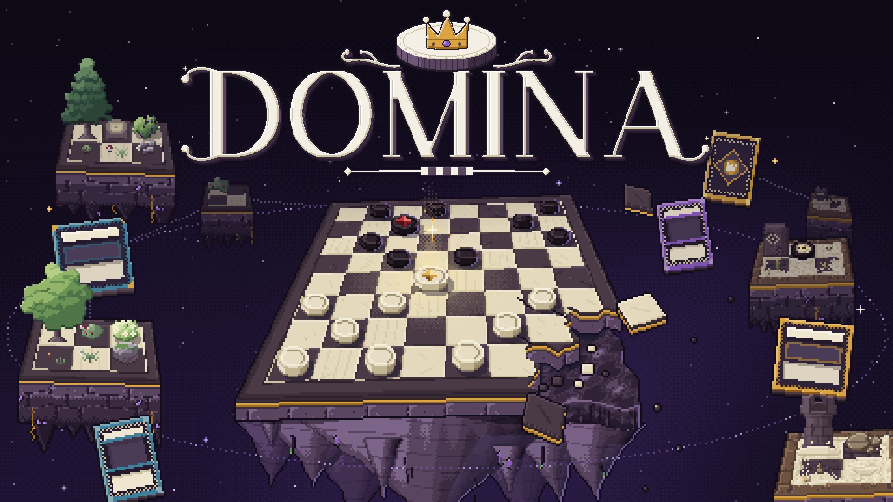
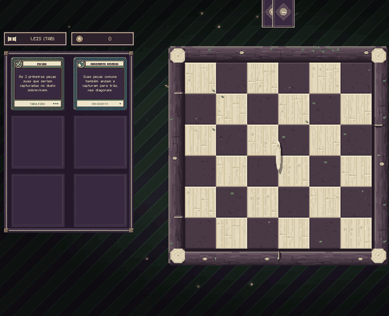
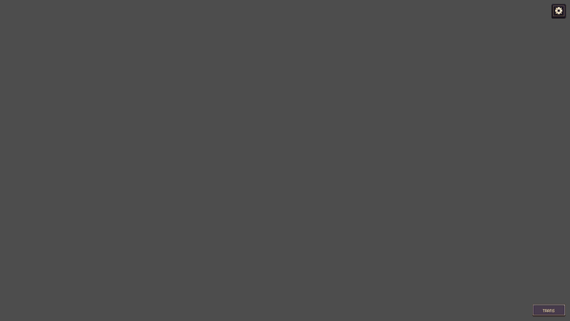
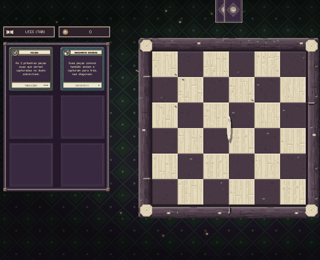

<p align="center">
  
</p>

# DOMINA

Roguelite de damas. Você atravessa um mapa de ilhas flutuantes, duela em tabuleiros que mudam de regra a cada partida e monta o seu jogo com **Leis** (que alteram as regras) e **Cartas de Ação** (que quebram as regras na hora certa).

> **Status:** alpha `0.7.6`. Feito com Godot e GDScript, em desenvolvimento ativo. Muita coisa ainda vai mudar.

<p align="center">
  
  <br>
  <sub>Um duelo só com Leis: Escudo e Movimento Reverso ativas, sem Cartas de Ação.</sub>
</p>

## O jogo

Uma partida de damas comum termina quando um lado fica sem peças. Em DOMINA, o caminho até lá é outro:

- **Leis:** são regras permanentes que você carrega durante a run. Uma lei pode deixar a captura opcional, promover peças que pisam no centro, mudar a mobilidade das peças, e assim por diante deixando o jogo cada vez mais caótico.
- **Cartas de Ação:** poderes de uso único por duelo, tirados do seu baralho. Podem eliminar uma Dama, converter uma peça inimiga, criar pontes, plantar árvores e cactos, girar uma moeda que decide a sorte de uma peça.
- **Mapa de ilha:** cada run é uma trilha de nós: duelos, duelos fortes, eventos, lojas, apostas, altares de Leis e, no final do bioma, um chefe.
- **Biomas e chefes:** cada um com tabuleiro tematizado, visual e chefe próprios. Cada chefe impõe leis próprias que mudam as regras de maneira especial, e comenta sobre a partida enquanto você joga.
- **Morte Súbita:** se o duelo demora para acabar, entra a morte súbita deixando o jogo mais dinâmico. O vitorioso é decidido após a contabilidade de quem tem mais peças.
- **Grimório:** a progressão entre runs. Você ganha Coroas no fim de uma run, desbloqueia novas Leis ou Cartas e ainda tem a opção de escolher o que levar na mochila para iniciar o jogo preparado.

<p align="center">
  
  <br>
  <sub>No Grimório, gaste Coroas para sortear no Oráculo e desbloquear uma Lei ou Carta nova.</sub>
</p>

<p align="center">
  
  <br>
  <sub>Uma carta sendo uasada na prática (essa promove uma peça comum à dama instantâneamente)</sub>
</p>

Existe um tutorial que o jogador pode acessar dentro do jogo (botão **Tutorial** no menu) que te guia pelos pontos básicos.

## Como jogar

| Ação | Controle |
| --- | --- |
| Mover uma peça | Clique na peça e na casa de destino |
| Usar uma Carta | Clique na carta (ou arraste até o alvo) |
| Ver as Leis ativas | `Tab` (ou `I` no mapa) |
| Configurações e Fechar janelas| `Esc` |


O jogo roda em 1920×1080 e escala para outras resoluções no menu de configurações.

## Rodando o projeto

Você precisa do [Godot 7.5](https://godotengine.org/download) (o projeto foi salvo nessa versão).

1. Clone o repositório:
   ```bash
   git clone https://github.com/mioj0kt/project-domina
   ```
2. Abra o Godot, clique em **Importar** e selecione o `project.godot` na raiz da pasta.
3. Na primeira abertura o Godot importa as imagens, o que pode levar alguns minutos.
4. Aperte `F5` para jogar. A cena inicial é `scenes/splash_view.tscn`.

Para gerar um executável, use **Projeto → Exportar**. O repositório já tem um preset para Windows (`export_presets.cfg`).

## Estrutura do repositório

## Estrutura do repositório

```
assets/
  audio/
    musica/         mapa (menu e um tema por bioma) e duelo (por bioma e por chefe, em seções)
    sfx/            efeitos por tipo: duelo, cartas, moedas, chefes, vozes, cassino, grimório, interface
  fonts/            fonte pixel (m5x7)
  theme/            tema da interface
  video/            vídeo de abertura
  sprites/
    biomas/         arte de cada bioma: floresta, deserto e mina (tabuleiro, trilhas do mapa, chefe, gruta)
    cards/          Cartas de Ação: faces, ícones e versos
    events/         cenas dos eventos e cenário da biblioteca
    fx/             efeitos animados (raízes, cipós, vaga-lumes etc.)
    hud/            painéis, botões e ícones da interface
    mapa/           nodos, anéis e a base de pedra das ilhas (uma por bioma)
    menu/           menu e ilhas flutuantes do fundo
    pieces/         peças e Damas
    retratos/       rostos falantes do Guia, do Irmão e dos chefes
    rules/          Leis: artes e versos
    tabuleiro/      peças do tabuleiro padrão
    tutorial/       arte própria do tutorial
    ui/             elementos de interface avulsos
scenes/             todas as cenas (.tscn)
scripts/
  autoload/         progresso, run atual, configurações, transição de cena, música e efeitos sonoros
  duel/             tabuleiro, regras de movimento, IA, turnos e Morte Súbita
    modes/          duelo padrão, forte e de chefe (floresta, deserto e mina)
    boss/           falas, entradas e efeitos das leis dos chefes
    fx/             efeitos visuais do duelo
    ui/             HUD, indicador de vez e revelação da carta do inimigo
  cards/            Cartas de Ação: baralho e recompensas
    catalog/        uma carta por arquivo
    visuals/        desenho das cartas
    modals/         janelas de recompensa e de espiar cartas
  rules/            Leis: pipeline de eventos
    catalog/        uma Lei por arquivo (boss/ tem as leis de chefe)
    modals/         janelas de recompensa e de descarte de Lei
  map/              geração e tela do mapa, trilhas, grutas da mina, tempestade e base das ilhas
    nodes/          loja, evento (com a cena encenada), aposta, roleta, altar e Arcano
  backgrounds/      fundos animados (biomas, espaço, tempestade de areia)
  ui/               desenho em pixel, cores das peças, transições e efeitos compartilhados
  data/             tabelas de sorteio (loot_tables.gd)
  menu/             menu, Grimório e Oráculo, personalização da peça, fim de run
  tutorial/         tutorial guiado
  debug/            atalhos e console de depuração
```

## Contribuindo

Ainda é um projeto pessoal em alpha. Sugestões e relatos de bug são bem-vindos nas Issues. Se for abrir um Pull Request, abra antes uma Issue contando o que pretende mudar.

## Licença e créditos

© 2026 Wrong Moon. Todos os direitos reservados. Código e arte não podem ser copiados, modificados ou redistribuídos sem permissão.

- Design, programação e sprites: Wrong Moon
- Fonte: [m5x7](https://managore.itch.io/m5x7), de Daniel Linssen
- Engine: [Godot Engine](https://godotengine.org) (licença MIT)
- Efeitos sonoros: criados do zero pela Wrong Moon, sintetizados por código (Python + NumPy), sem samples nem bibliotecas de som de terceiros.
